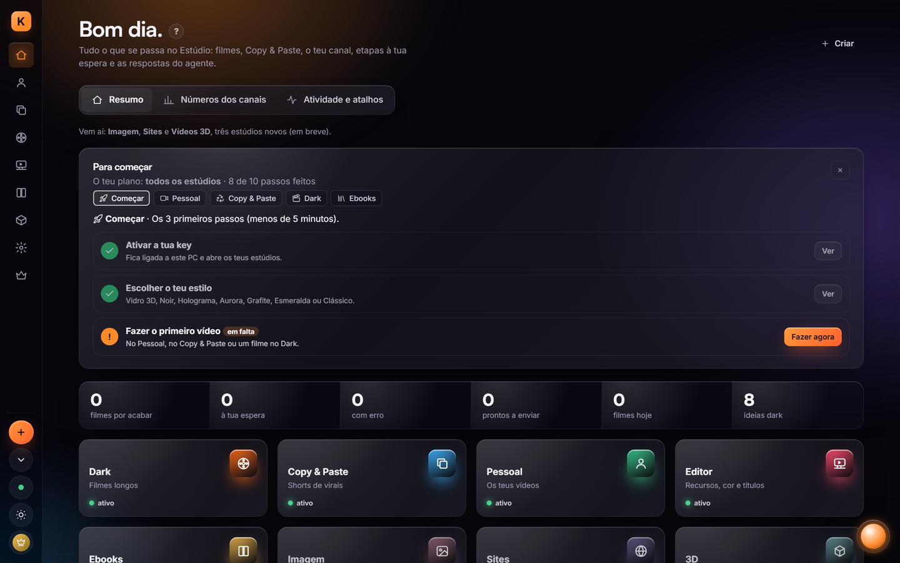
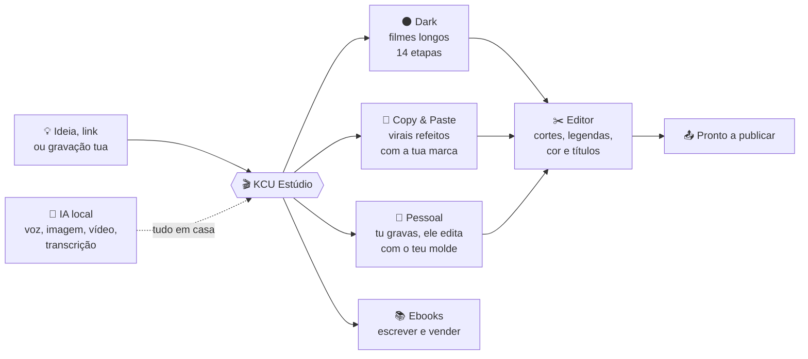
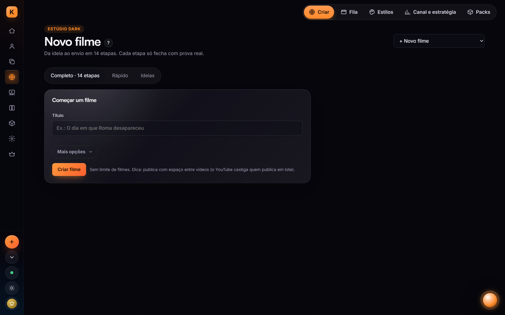
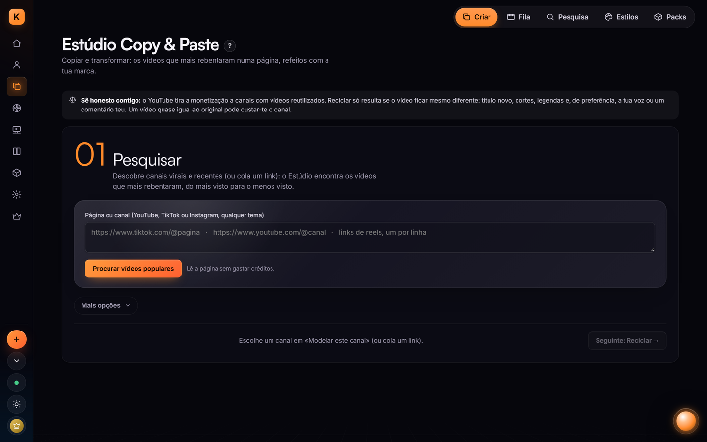
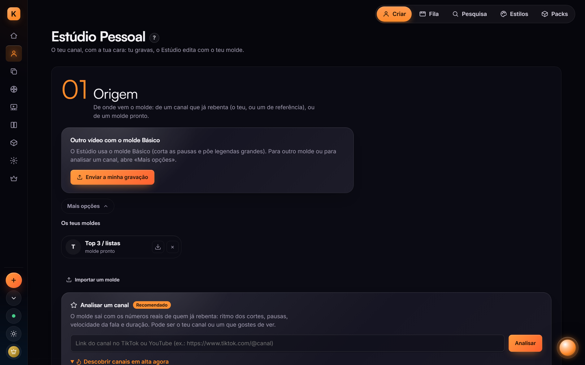

# KCU Estúdio 🎬

**O nosso estúdio de vídeo com IA, a correr no nosso próprio PC.** Filmes longos, shorts, os vídeos do teu canal, ebooks: da ideia ao vídeo pronto a publicar, sem pagar mensalidades a 10 ferramentas diferentes.

> Esta página é só uma montra: mostra o que o Estúdio faz e como está pensado. O código não é público.
>
> *Our AI video studio, running on our own PC. This page is a showcase only; the code is not public. (In Portuguese.)*

## Como funciona

## Os estúdios

### 🌑 Dark: filmes longos
Da ideia ao envio em **14 etapas**, e cada etapa só fecha com prova real. Há modo completo, modo rápido e um banco de ideias com vídeos virais recentes.

### 🔁 Copy & Paste: virais refeitos
Cola uma página do YouTube, TikTok ou Instagram. O Estúdio encontra os vídeos que mais rebentaram e ajuda-te a refazê-los **com a tua marca**: título novo, cortes, legendas e a tua voz. E diz-te a verdade: um vídeo quase igual ao original pode custar-te o canal.

### 🙋 Pessoal: o teu canal, com a tua cara
Tu gravas e o Estúdio edita com o **teu molde**: corta as pausas, põe legendas grandes e segue o ritmo. O molde pode vir de um canal que já rebenta (o teu ou um de referência), com os números reais: ritmo dos cortes, pausas, velocidade da fala e duração.

### ✂️ Editor e 📚 Ebooks
O Editor trata dos recursos, da cor e dos títulos dos vídeos. Os Ebooks servem para escrever e vender.

### Em breve
**Imagem**, **Sites** e **Vídeos 3D**.

## Porque o fizemos

- **Uma ferramenta em vez de dez.** Edição, legendas, vozes, pesquisa de virais, títulos: tudo no mesmo sítio.
- **Corre em casa.** A IA pesada (voz, imagem, vídeo, transcrição) corre no nosso PC. Ver o [kcu-stack](https://github.com/KCUServices/kcu-stack).
- **Honesto.** Avisa quando uma ideia pode prejudicar o teu canal, em vez de te deixar descobrir da pior maneira.

## Vê-lo a trabalhar

Vamos mostrar o Estúdio a ser usado, **sem cortes**, nos vídeos da série. As vossas ideias decidem o que melhora a seguir: deixa-as nas [Discussions](https://github.com/orgs/KCUServices/discussions/categories/ideas).

Queres saber quando abre a mais pessoas? Segue-nos no Instagram [@kcu.services](https://www.instagram.com/kcu.services).

## Licença e marca

O KCU Estúdio **não é código aberto**: esta página é só uma montra. O nome KCU, os logótipos e todas as imagens desta página (os prints do Estúdio incluídos) são da KCU Services, com **todos os direitos reservados**. Não podem ser copiados nem usados noutros produtos, páginas ou anúncios. Ver [MARCA.md](MARCA.md).
